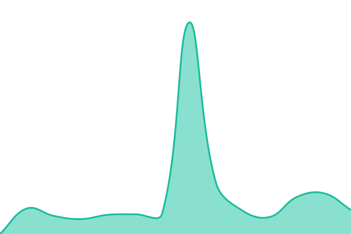
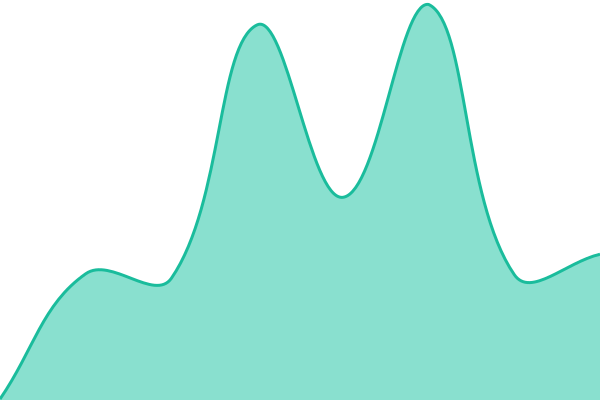
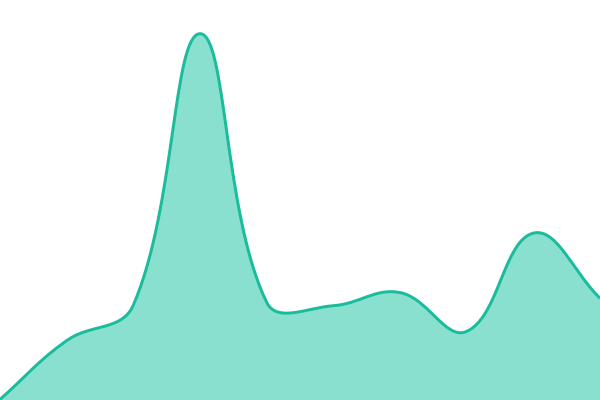

# [📈 Live Status](https://status.senchin.dpdns.org): <!--live status--> **🟩 All systems operational**

This repository contains the open-source uptime monitor and status page for [oxarlly](https://status.senchin.dpdns.org), powered by [Upptime](https://github.com/upptime/upptime).

With [Upptime](https://upptime.js.org), you can get your own unlimited and free uptime monitor and status page, powered entirely by a GitHub repository. We use [Issues](https://github.com/oxarlly/status/issues) as incident reports, [Actions](https://github.com/oxarlly/status/actions) as uptime monitors, and [Pages](https://status.senchin.dpdns.org) for the status page.

<!--start: status pages-->
<!-- This summary is generated by Upptime (https://github.com/upptime/upptime) -->
<!-- Do not edit this manually, your changes will be overwritten -->
<!-- prettier-ignore -->
| URL | Status | History | Response Time | Uptime |
| --- | ------ | ------- | ------------- | ------ |
|  [千顷暝隅](https://senchin.dpdns.org) | 🟩 Up | [千顷暝隅.yml](https://github.com/oxarlly/status/commits/HEAD/history/千顷暝隅.yml) | 

 740ms
     
 | 

<a href="https://oxarlly.github.io/status/history/千顷暝隅">100.00%</a>
    

|  [Artalk](https://artalk.senchin.dpdns.org) | 🟩 Up | [artalk.yml](https://github.com/oxarlly/status/commits/HEAD/history/artalk.yml) | 

 1064ms
     
 | 

<a href="https://oxarlly.github.io/status/history/artalk">100.00%</a>
    

|  [CDN](https://cdn.senchin.dpdns.org) | 🟩 Up | [cdn.yml](https://github.com/oxarlly/status/commits/HEAD/history/cdn.yml) | 

 418ms
     
 | 

<a href="https://oxarlly.github.io/status/history/cdn">100.00%</a>
    

|  [国际网路](https://et.senchin.dpdns.org) | 🟩 Up | [国际网路.yml](https://github.com/oxarlly/status/commits/HEAD/history/国际网路.yml) | 

 884ms
     
 | 

<a href="https://oxarlly.github.io/status/history/国际网路">100.00%</a>
    

|  [SubStracker](https://substracker.senchin.dpdns.org) | 🟩 Up | [sub-stracker.yml](https://github.com/oxarlly/status/commits/HEAD/history/sub-stracker.yml) | 

 222ms
     
 | 

<a href="https://oxarlly.github.io/status/history/sub-stracker">100.00%</a>
    

<!--end: status pages-->

[**Visit our status website →**](https://status.senchin.dpdns.org)

## 📄 License

- Powered by: [Upptime](https://github.com/upptime/upptime)
- Code: [MIT](./LICENSE) © [Anand Chowdhary](https://anandchowdhary.com)
- Data in the `./history` directory: [Open Database License](https://opendatacommons.org/licenses/odbl/1-0/)
